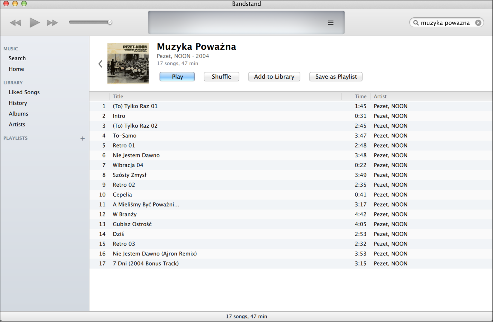

# Bandstand

A music player for [Mavernix](https://github.com/Mavernix/mavernix). Search YouTube Music, play songs, keep playlists and liked songs. No account needed.

It takes its look from whatever Mavernix theme you're running.



## Install

Open the App Store in Mavernix and get Bandstand. It comes with everything it needs.

## Build

You need Qt 6 (with Qt Multimedia), meson, python, `python-ytmusicapi`, `yt-dlp` and `deno`.

```sh
meson setup build
meson compile -C build
```

Start `build/bandstand` from a Mavernix session.

Your library lives in `~/.local/share/bandstand` as plain JSON files.

Right-click a song for what you can do with it. On Home's Recently Played shelf and in History, that includes Remove from History. Don't Suggest This Song keeps a song off Home's shelves and out of History, and Up Next skips it unless you pick it yourself; Liked Songs and your playlists keep it. Search finds it still, and right-clicking it there offers Suggest This Song Again. Hidden songs are listed in `hidden.json`.

Songs you've played are kept in `~/.cache/bandstand/audio`, so they start at once the next time, and so is the song that comes next in Up Next. Once that folder holds 2 GB, the songs played longest ago make room. `cache_folder` and `cache_limit_mb` in the config's `[music]` table change both; a limit of 0 keeps nothing.

## Keys

| Key | Does |
|---|---|
| Space | Play or pause |
| Ctrl+→ / Ctrl+← | Next song / previous song |
| Ctrl+↑ / Ctrl+↓ | Louder / quieter |
| Ctrl+F | Search |

The media keys work everywhere, also while Bandstand is in the background: Bandstand is an MPRIS player, so `playerctl`, which Mavernix runs for those keys, controls it.

The button at the end of the seek bar repeats: once for the whole list (the album or playlist starts over after its last song), twice for the song playing, a third time turns it off. `playerctl loop` sets it too.

## Release

Push a version tag, such as `v0.2.0`, with the release notes as the tag's message. `.github/workflows/release.yml` then builds the bundle the App Store installs (`packaging/make-bundle`) and publishes the release. `mavernix-app.toml` is what the store shows; how that works is in Mavernix's [docs/app-store.md](https://github.com/Mavernix/mavernix/blob/main/docs/app-store.md).

When songs stop playing because YouTube changed something, update yt-dlp in `packaging/bundle-requirements.txt` and make a new release.

## License

GPLv3
