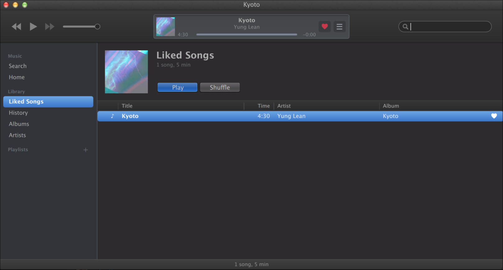

# Bandstand

A music player for [Mavernix](https://github.com/Mavernix/mavernix). Search YouTube Music, play songs, keep playlists and liked songs. No account needed.

It takes its look from whatever Mavernix theme you're running.



## Build

You need Qt 6 (with Qt Multimedia), meson, python, `python-ytmusicapi`, `yt-dlp` and `deno`.

```sh
meson setup build
meson compile -C build
```

Start `build/bandstand` from a Mavernix session.

Your library lives in `~/.local/share/bandstand` as plain JSON files.

## License

GPLv3
